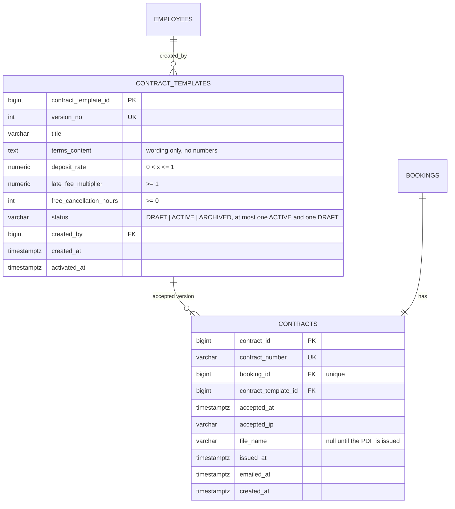

# Proposed ERD change: versioned contract templates

Status: proposed on 2026-10-23 by Phúc. `docs/reference/erd_car.drawio` is unchanged (original snapshot).
Needs Kiệt's approval because `contracts` belongs to the booking lifecycle.

## What changes

| Before | After |
|---|---|
| `policies`: free-text rules, edited in place | removed |
| `contracts.terms_snapshot`: text copied at booking time | removed; the contract points to an immutable template version |
| `contracts.contract_status` (DRAFT/SIGNED/ACTIVE/COMPLETED/CANCELLED) | removed; validity follows `bookings.status`, so the two cannot drift apart |
| `contracts.signed_at`, `signature_type = 'DIGITAL_CHECK'` set automatically when the deposit was paid | `accepted_at`, `accepted_ip`, recorded when the customer ticks the checkbox (clickwrap) |
| `contracts.file_pdf_url` pointing to files that never existed | `file_name` of a generated PDF in a private folder, plus `issued_at`, `emailed_at` |
| 50% deposit, 200% late fee, 72 h free cancellation hard-coded in Java and HTML | typed columns on `contract_templates`, read from the version the booking accepted |

## Diagram

## Rules

1. A version is editable only while it is DRAFT. Activating a draft archives the previous ACTIVE version.
2. A booking stores the version id it accepted. Deposit and late fee are computed from that version, never from the currently active one.
3. A new business rule (for example an excess-kilometre fee) means a code change plus a new nullable column; NULL means "rule not part of this version", so older contracts are never retro-actively changed.

No migration script: the team resets the database and recreates it from `database/schema.sql` + `database/seed.sql`.
