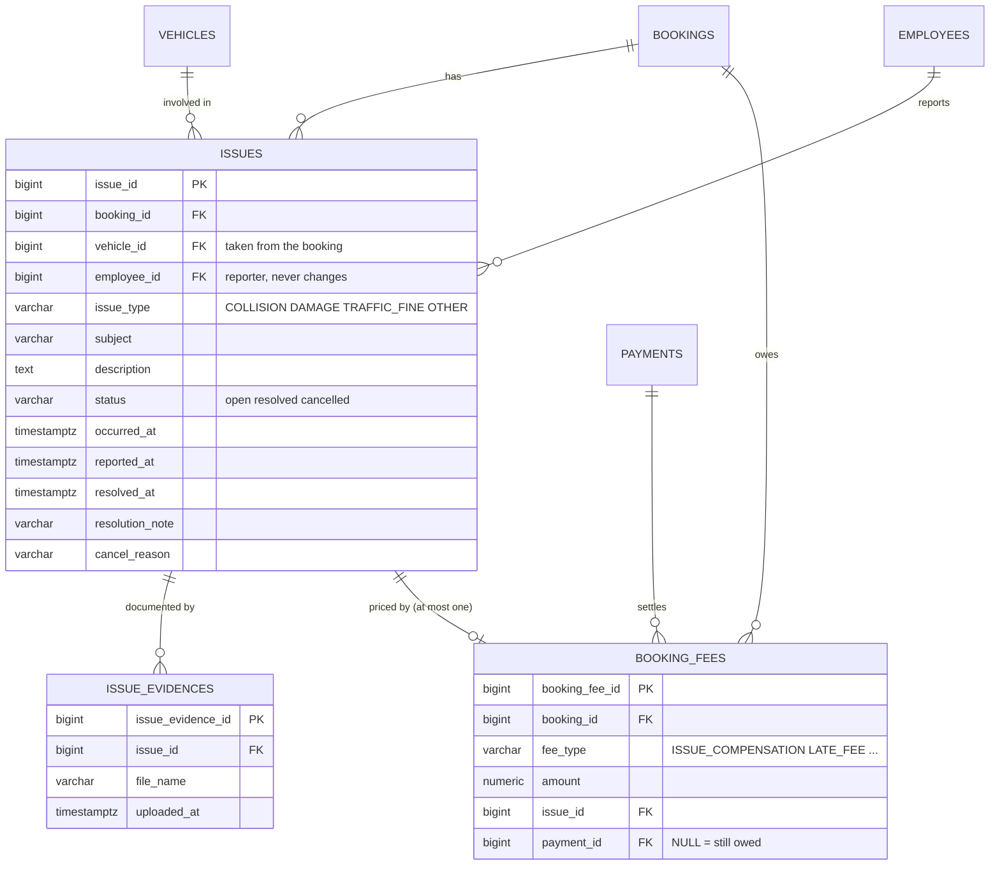

# Proposed ERD change: Issue (incidents during a rental) and retired vehicles

Status: proposed on 2026-11-01 by Phúc. `docs/reference/erd_car.drawio` is unchanged (original snapshot).
Touches `issues`, `booking_fees`, `payments` (new payment type) and `vehicles`, so it needs Kiệt's approval
together with the settlement changes. Background: [GLOSSARY.md](../../GLOSSARY.md) and
[ADR 0001](../adr/0001-issue-tracks-customer-liability-only.md).

## What changes

| Before | After |
|---|---|
| `issues.booking_id` / `employee_id` nullable | both NOT NULL: an Issue is always about a rental the customer received, filed by an employee |
| `issues.slot_id` | removed (the slot is reachable through the booking) |
| one `issues.evidence_url` | removed; many photos in `issue_evidences`, stored privately |
| `issues.issue_type` free text (`SCRATCH`) | `COLLISION`, `DAMAGE`, `TRAFFIC_FINE`, `OTHER` |
| `issues.status` `open`, `in_progress`, `resolved` | `open`, `resolved`, `cancelled`: an Issue tracks the **fee** (money), not the repair |
| no description, no times | `description`, `occurred_at` (when it happened), `resolved_at`, `resolution_note`, `cancel_reason` |
| the amount had no home | stays in `booking_fees` (`fee_type = ISSUE_COMPENSATION`, replacing `DAMAGE_COMPENSATION`); there is no `fine_amount` on `issues` |
| nothing said whether a fee was collected | `booking_fees.payment_id` (NULL = still owed) points at the payment that settled it |
| `vehicles.status` `available`, `rented`, `maintenance` | adds `retired`: out of service for good, never rented or inspected again |

## Diagram

## Rules

Enforced by the database: the two CHECK lists on `issues`, the NOT NULL foreign keys, and the `retired` value in
`vehicles.status`.

Enforced by `IssueService` (a later ticket), not by triggers:

1. An Issue is created only for a booking that is `active` or `completed`.
2. `open` can become `resolved` (needs a note) or `cancelled` (needs a reason). A `resolved` Issue can be reopened
   or cancelled only by an admin, and only while its fee has no paid or pending payment. After that it is locked.
3. Only `IssueService` creates, changes or deletes the `ISSUE_COMPENSATION` fee of an Issue; cancelling removes it.
4. A `retired` vehicle can never leave that status.

No migration script: the team resets the database from `database/schema.sql` + `database/seed.sql`.
