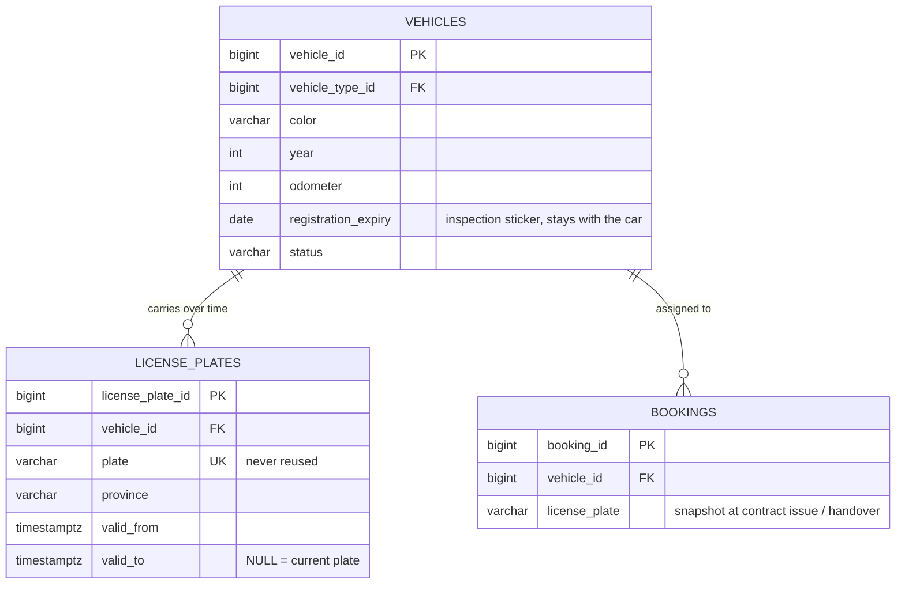

# Proposed ERD change: plate history per vehicle (1-N)

Status: proposed on 2026-10-24 by Phúc after the lecturer pointed out that one car can carry several plates over its life.
`docs/reference/erd_car.drawio` is unchanged (original snapshot). Touches `vehicles`, `license_plates` and `bookings`,
so it needs Kiệt's approval together with the contract change in [contract-templates-erd.md](contract-templates-erd.md).

## What changes

| Before | After |
|---|---|
| `vehicles.license_plate_id` UNIQUE FK, 1:1 with `license_plates` | removed; `license_plates.vehicle_id` NOT NULL FK, so **one vehicle has many plates (1-N)** |
| a plate row could exist without a vehicle ("Unassigned") | a plate always belongs to exactly one vehicle and is never reused (`plate` stays UNIQUE) |
| no notion of time | `valid_from` / `valid_to`: the period the plate was on the car; `valid_to IS NULL` = current plate |
| `license_plates.registration_expiry` | moved to `vehicles.registration_expiry`: the inspection sticker belongs to the car, so changing the plate does not renew it |
| `bookings` found the plate through the vehicle, so an old booking showed the car's new plate after a plate change | `bookings.license_plate` copies the plate text when the contract is issued and again at handover (check-in) |

## Diagram

## Rules enforced by the database

1. `EXCLUDE USING gist (vehicle_id WITH =, tstzrange(valid_from, valid_to) WITH &&)`: a vehicle never has two plates at the same time. This also guarantees at most one open-ended (current) plate per vehicle. It uses the `btree_gist` extension that `schema.sql` already installs.
2. `CHECK (valid_to IS NULL OR valid_to > valid_from)`.
3. `UNIQUE (plate)`: a retired plate can never be issued to another vehicle.

## Application behaviour

- **Change plate** (`LicensePlateService.changePlate`): in one transaction the current plate gets `valid_to = now`, then the new plate is inserted with `valid_from = now`, so there is no gap and no overlap. Not allowed while the vehicle is `rented`.
- The plate field of the vehicle edit form is read-only; the plate is changed on the plate-history page so the old plate always stays in the record.
- A booking shows its own `license_plate` when it has one, otherwise the vehicle's current plate.

## Why 1-N and not N-N

Two cars cannot swap plates (the plate is tied to the registration papers of one car), and a retired plate is not handed to another car in this system. If the business ever needs to reissue plates, replace `license_plates.vehicle_id` with an assignment table `(vehicle_id, license_plate_id, assigned_from, assigned_to)` and put the same exclusion constraint on both `vehicle_id` and `license_plate_id`.

No migration script: the team resets the database from `database/schema.sql` + `database/seed.sql`.
